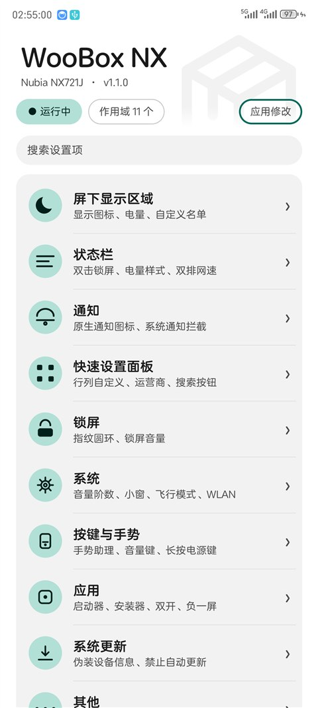
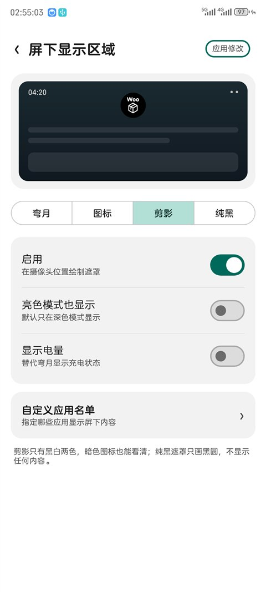
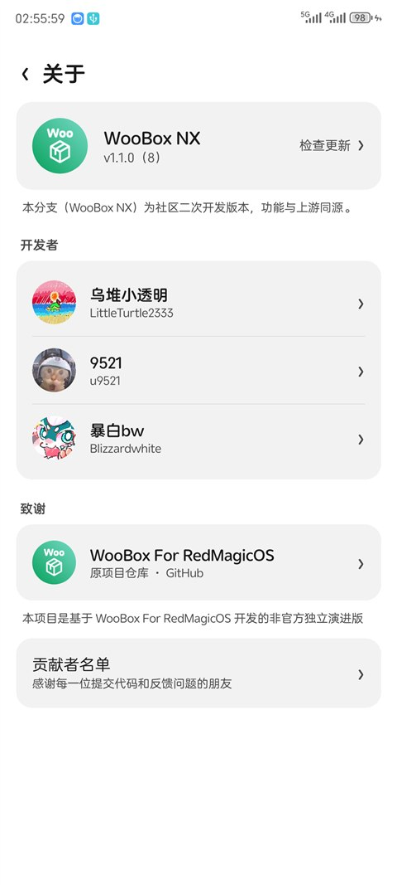

   
   <h1>WooBox NX</h1>
   

       <b><a href="./doc/README_EN.md">English</a> | 简体中文</b>
   

   
基于 MyOS14 (Android 14) 适配的努比亚系统增强工具箱

---

### 模块说明

- 仅适配 **MyOS14 / RedMagicOS 9（Android 14）**，其余版本不保证可用
- 包名：`com.bw.wooboxnx`
- 模块名：WooBox NX
- 当前版本：1.1.0

本仓库是基于 [WooBox For RedmagicOS](https://github.com/u9521/WooBoxForRedmagicOS) 的二次开发分支，
包名与上游不同，两者**配置与备份互不通用**，安装前请先卸载上游版本。

与原版的差异：重做了 MD3 设置界面（单页分类 + 搜索 + 待生效清单）、
屏下区域支持弯月/图标/剪影/纯黑与电量显示、指纹圆环、应用名单页，
并移除了旧版界面依赖。

上游开发者：[@u9521](https://github.com/u9521)
原开发者：[酷安@乌堆小透明](http://www.coolapk.com/u/883441)

---

### 使用说明

1. 安装 APK 后，在 LSPosed 管理器中启用「WooBox NX」并勾选作用域（共 11 个）
2. 首次启用或模块更新后，需要**重启手机**才能让系统框架作用域生效
3. 修改设置后点右上角「应用修改」，按提示重启作用域或手机
4. 主页状态胶囊：绿色「运行中」表示常驻作用域均已注入

---

### 界面预览

  
  
  

---

### 下载地址

- 本仓库：[Blizzardwhite/WooBoxNX](https://github.com/Blizzardwhite/WooBoxNX)
- APK 下载：[v1.1.1](https://github.com/Blizzardwhite/WooBoxNX/releases/tag/v1.1.1)

---

### 第三方开源引用

##### GNU General Public License v3.0
[qqlittleice/MiuiHome](https://github.com/qqlittleice/MiuiHome)

[yujincheng08/BiliRoaming](https://github.com/yujincheng08/BiliRoaming)

[Mikanoshi/CustoMIUIzer](https://code.highspec.ru/Mikanoshi/CustoMIUIzer)

[LSPosed/DisableFlagSecure](https://github.com/LSPosed/DisableFlagSecure)

##### GNU General Public License v2.0

~~[LSPosed/CorePatch](https://github.com/LSPosed/CorePatch)~~(不再集成，有需要点击链接下载)
##### GNU Lesser General Public License v3.0

[LuckyPray/DexKit](https://github.com/LuckyPray/DexKit)

---

### License

[GNU General Public License v3.0](./LICENSE)
