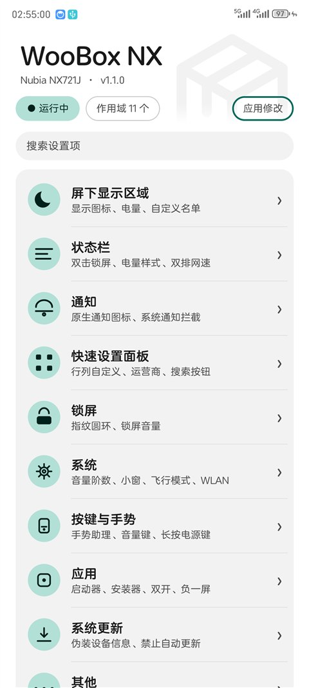
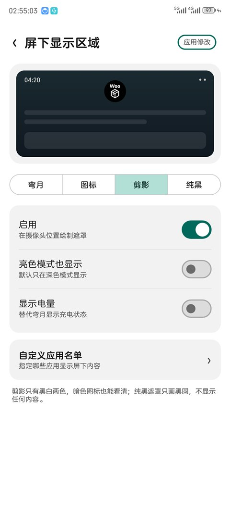
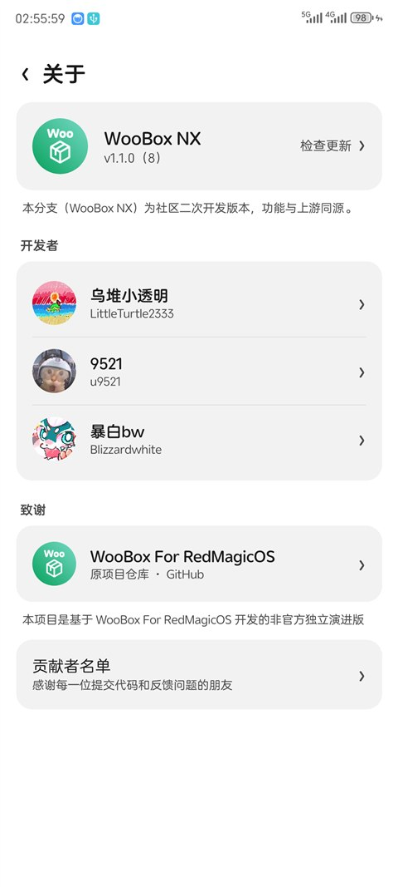



   
   <h1>WooBox NX</h1>
   

       <b>English | <a href="../README.md">Simplified Chinese</a></b>
   

   
System tweak toolbox for Nubia, adapted to MyOS14 (Android 14)

---

### Module Description

- Only supports **MyOS14 / RedMagicOS 9 (Android 14)**
- Package: `com.bw.wooboxnx`
- Module name: WooBox NX
- Version: 1.1.4

This repository is a community fork of [WooBox For RedmagicOS](https://github.com/u9521/WooBoxForRedmagicOS).
The package name differs from upstream, so settings and backups are **not interchangeable**.
Uninstall the upstream module before installing this one.

Differences from upstream: rebuilt MD3 settings UI (single-page categories, search, pending-changes dialog),
under-display area with moon / icon / silhouette / pure black plus battery, fingerprint ring,
custom app list, voice wakeup / long-press power opening the default assistant voice UI (also on the lock screen), and the legacy settings UI has been removed.

Upstream developer: [@u9521](https://github.com/u9521)
Original developer: [CoolApk@乌堆小透明](http://www.coolapk.com/u/883441)

---

### Usage

1. Install the APK, then enable "WooBox NX" in the LSPosed manager and select all scopes (12)
2. A reboot is required after the first enable or a module update, so the system framework scope takes effect
3. After changing settings, tap "应用修改" (Apply) at the top right and follow the prompt
4. The status chip shows green "运行中" when all resident scopes are injected

---

### Screenshots

  
  
  

---

### Download Links

- Repository: [Blizzardwhite/WooBoxNX](https://github.com/Blizzardwhite/WooBoxNX)
- APK: [v1.1.4](https://github.com/Blizzardwhite/WooBoxNX/releases/tag/v1.1.4)

---

### Third-party open source

##### GNU General Public License v3.0
[qqlittleice/MiuiHome](https://github.com/qqlittleice/MiuiHome)

[yujincheng08/BiliRoaming](https://github.com/yujincheng08/BiliRoaming)

[Mikanoshi/CustoMIUIzer](https://code.highspec.ru/Mikanoshi/CustoMIUIzer)

[LSPosed/DisableFlagSecure](https://github.com/LSPosed/DisableFlagSecure)

##### GNU Lesser General Public License v3.0

[LuckyPray/DexKit](https://github.com/LuckyPray/DexKit)

---

### License

[GNU General Public License v3.0](../LICENSE)
